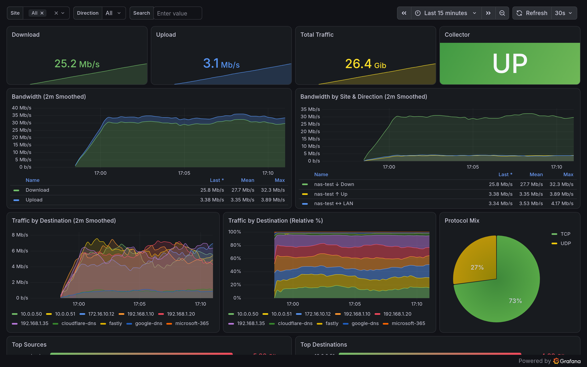
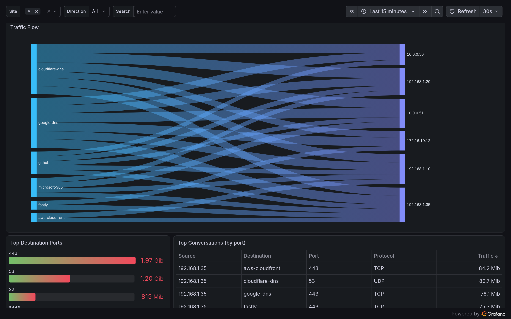
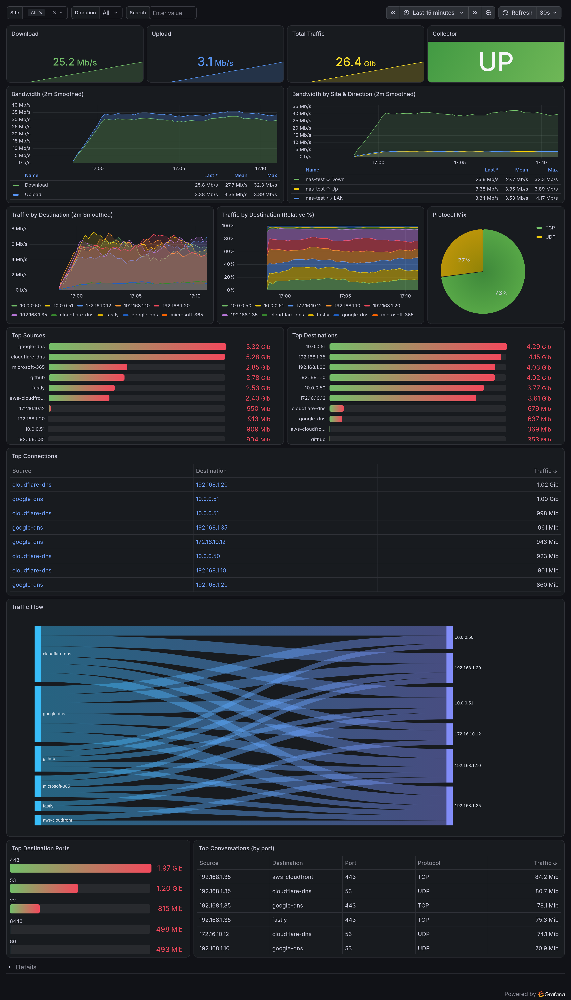
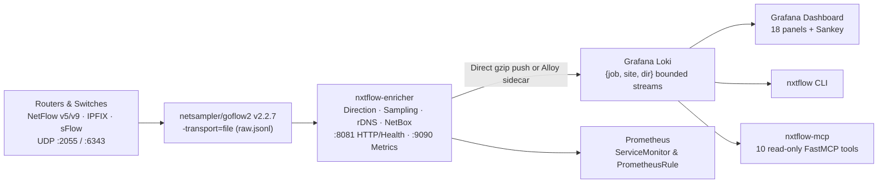

<p align="center">
  
</p>

<h1 align="center">nxtflow — AI-Ready Multi-Site NetFlow, IPFIX &amp; sFlow Telemetry</h1>

<p align="center">
  <a href="https://github.com/nertwork/nxtflow/actions/workflows/ci.yml"></a>
  <a href="https://github.com/nertwork/nxtflow/releases/latest"></a>
  <a href="https://nertwork.github.io/nxtflow/"></a>
  <a href="https://github.com/nertwork/nxtflow/pkgs/container/nxtflow-enricher"></a>
  <a href="https://github.com/nertwork/nxtflow/pkgs/container/charts%2Fnxtflow"></a>
  <a href="https://coderabbit.ai"></a>
  <a href="https://github.com/nertwork/nxtflow/graphs/contributors"></a>
  <a href="LICENSE"></a>
</p>

**`nxtflow`** is an open-source **NetFlow v5/v9, IPFIX, and sFlow** observability and AI-analysis platform for Docker Compose and Kubernetes. It pairs upstream [`netsampler/goflow2`](https://github.com/netsampler/goflow2) with a lightweight Python enricher (`nxtflow-enricher`), bounded-cardinality Grafana Loki storage, an 18-panel Grafana dashboard, a terminal CLI (`nxtflow`), and a read-only FastMCP server (`nxtflow-mcp`) so both engineers and AI coding assistants can query network traffic history in seconds.

## Dashboard Preview

<p align="center">
  
</p>

<p align="center">
  
</p>

<details>
<summary>View full-page 18-panel Grafana dashboard screenshot</summary>

<p align="center">
  
</p>

</details>

---

## Architecture



---

## Key Capabilities

- **Dual-Mode Helm Chart (`charts/nxtflow`):**
  - **Standalone (`tags.standalone=true`):** Batteries-included install deploying `loki` (SingleBinary filesystem TSDB), minimal `prometheus`, `grafana` (auto-provisioned datasources + 18-panel dashboard), `goflow2` + `nxtflow-enricher`, and `nxtflow-mcp`.
  - **Integrated (`tags.standalone=false`):** Plugs into your existing Loki, `kube-prometheus-stack` (`ServiceMonitor` + `PrometheusRule`), and Grafana sidecar (`grafana_dashboard: "1"`).
  - **Collector-Only (`examples/values-collector-only.yaml`):** Lightweight edge collector shipping flows from remote sites into a central Loki.
- **5000-Series-Safe Loki Schema:** Writes only 3 bounded stream labels per site (`{job, site, dir}`) and protects port aggregations with `dst_port =~ '.{1,4}' | __error__=''`.
- **7-Tier Host Resolution:** Combines `staticHosts`, custom `internalCidrs`, `wanIps`, optional NetBox IPAM sync, built-in public CDN/DNS CIDRs (`103` IPv4/IPv6 ranges), and a bounded LRU+TTL reverse DNS cache.
- **AI-Native Telemetry (`nxtflow` CLI & `nxtflow-mcp`):** Query top talkers, top destinations, 5-tuple host sessions, ports, and flow search via terminal or any MCP client (`stdio` or `streamable-http`).

---

## Quick Start (Docker Compose)

Run the full standalone stack (**GoFlow2 + `nxtflow-enricher` + Loki + Prometheus + Grafana + `nxtflow-mcp`**) locally or on any Docker host in three commands:

```bash
cp .env.example .env
# Edit .env if needed (e.g. NXTFLOW_GRAFANA_PORT=3030 if port 3000 is already in use)
./scripts/up.sh
```

Or enable the synthetic NetFlow v9 traffic generator (`--profile demo`) and verify the full pipeline end-to-end before pointing a physical router at UDP `:2055` / `:6343`:

```bash
./scripts/up.sh --demo        # or: docker compose --profile demo up -d
./scripts/verify-stack.sh     # checks health endpoints, Grafana provisioning, and Loki flow ingestion
```

Once running:
- **Grafana Dashboard:** `http://localhost:${NXTFLOW_GRAFANA_PORT:-3000}/d/nxtflow-overview` (default login: `admin` / `nxtflow`)
- **Loki API:** `http://localhost:${NXTFLOW_LOKI_PORT:-3100}`
- **Prometheus UI:** `http://localhost:${NXTFLOW_PROMETHEUS_PORT:-9091}`
- **MCP Endpoint:** `http://localhost:${NXTFLOW_MCP_PORT:-8000}/mcp`
- **Send a one-shot test burst:** `python3 scripts/demo-flows.py --once`
- **Query via containerized CLI (no local Python install required):**
  `docker compose exec -e NXTFLOW_LOKI_URL=http://loki:3100 nxtflow-mcp nxtflow summary --range 15m`

Customize `docker/enricher/enricher.yaml` to add `wanIps`, `staticHosts`, or `internalCidrs`, and `docker compose up -d --force-recreate enricher` to apply.

-> **Full Docker Compose Guide:** [docs/docker-compose.md](docs/docker-compose.md) · [nertwork.github.io/nxtflow/docker-compose.html](https://nertwork.github.io/nxtflow/docker-compose.html)

---

## Quick Start (Helm)

### 1. Standalone (All-in-One)

Deploys the collector, enricher, Loki, Prometheus, Grafana, and MCP server in one release:

```bash
helm install nxtflow oci://ghcr.io/nertwork/charts/nxtflow \
  --namespace nxtflow --create-namespace \
  -f examples/values-standalone.yaml
```

Forward Grafana locally and open `http://localhost:3000/d/nxtflow-overview`:

```bash
kubectl port-forward -n nxtflow svc/nxtflow-grafana 3000:80
```

### 2. Integrated (Existing Loki, Prometheus & Grafana)

Connects to an existing Loki endpoint and provisions `ServiceMonitor`, `PrometheusRule`, and the Grafana dashboard ConfigMap:

```bash
helm install nxtflow oci://ghcr.io/nertwork/charts/nxtflow \
  --namespace monitoring \
  -f examples/values-integrated.yaml \
  --set externalLoki.url="https://loki.example.com"
```

### 3. Collector-Only (Remote Edge Site)

Deploys only the UDP collector and enricher for a remote branch site:

```bash
helm install nxtflow-edge oci://ghcr.io/nertwork/charts/nxtflow \
  --namespace nxtflow \
  -f examples/values-collector-only.yaml \
  --set collector.site="branch-west" \
  --set externalLoki.url="https://loki.example.com"
```

> **Note on `externalTrafficPolicy: Local`:** Keep `collector.service.externalTrafficPolicy=Local` on `LoadBalancer`/`NodePort` services so Kubernetes preserves the true source IP of your exporting routers instead of SNATing it.

---

## Customizing Site & Exporter Labels

Every enriched flow record is tagged with bounded Loki stream labels `{job, site, dir}` so you can aggregate and filter multi-site traffic without cardinality explosion:

1. **Site Label (`collector.site`):** Set a unique `collector.site` (for example `"us-east"`, `"branch-west"`, or `"lab"`) on each Helm release. New sites automatically appear in the Grafana `Site` dropdown and `nxtflow status`.
2. **Direction Classification (`enricher.classification`):** Configure `localCidrs` (your internal subnets) and `wanIps` (your router public/WAN IPs) so traffic is accurately tagged as `up`, `down`, or `lan`.
3. **Host & Service Aliases (`enricher.resolution`):** Map key IPs in `staticHosts` (such as `"192.168.1.1": "core-router"`), name internal subnets in `internalCidrs`, or enable `enricher.netbox.enabled=true` to sync IPAM hostnames automatically.

---

## Configuration & Environment Variables

The `nxtflow` CLI and `nxtflow-mcp` resolve settings in order: built-in defaults -> `~/.config/nxtflow/config.yaml` (or `--config` / `NXTFLOW_CONFIG_FILE`) -> environment variables:

| Environment Variable | Default | Description |
|---|---|---|
| `NXTFLOW_LOKI_URL` | `http://localhost:3100` | Base URL for the target Loki API |
| `NXTFLOW_JOB` | `nxtflow` | Loki `job` label to query (`collector.job`) |
| `NXTFLOW_TLS_VERIFY` | `true` | `true`, `false`, or path to a custom CA bundle |
| `NXTFLOW_LOKI_TOKEN` | `""` | Optional Bearer token for authenticated Loki |
| `NXTFLOW_LOKI_USER` / `NXTFLOW_LOKI_PASSWORD` | `""` | Optional Basic auth credentials for Loki |
| `NXTFLOW_LOKI_TENANT_ID` | `""` | Optional `X-Scope-OrgID` multi-tenant header |
| `NXTFLOW_EXCLUDED_HOSTS` | `multicast,link-local` | Comma-separated hostnames excluded from top-N views |

See [CLI, MCP Server & AI Skill Integration](docs/ai-integration.md) and [`charts/nxtflow/values.yaml`](charts/nxtflow/values.yaml) for the complete reference.

---

## CLI & MCP Quick Start

Install the Python package locally (with MCP server support):

```bash
pip install "nxtflow[mcp] @ git+https://github.com/nertwork/nxtflow.git"
# or with uv:
uv tool install --from "git+https://github.com/nertwork/nxtflow.git" "nxtflow[mcp]"
```

Query Loki from your terminal:

```bash
export NXTFLOW_LOKI_URL="http://localhost:3100"
nxtflow status
nxtflow summary --range 1h
nxtflow top-talkers 10 --range 15m
nxtflow host 192.168.1.10 --range 1h
nxtflow sessions 192.168.1.10
```

Run `nxtflow-mcp` over `stdio` (see `mcp/nxtflow.mcp.json` and `skills/nxtflow/SKILL.md`):

```bash
nxtflow-mcp --transport stdio
```

---

## Exporter Configuration Guides

Ready-to-use templates live in [`examples/exporters/`](examples/exporters/):

- [MikroTik RouterOS v7](examples/exporters/mikrotik-routeros.rsc)
- [Linux `softflowd`](examples/exporters/softflowd-linux.md)
- [pfSense & OPNsense](examples/exporters/pfsense-opnsense.md)
- [Cisco IOS-XE (Flexible NetFlow)](examples/exporters/cisco-ios-xe.txt)
- [UniFi Gateway](examples/exporters/unifi-gateway.md)

---

## Testing & Verification

Run the local audit, linter, Helm checks, and unit test suite before opening a pull request:

```bash
docker compose --env-file .env.example config -q
python3 scripts/security_audit.py
ruff check src tests scripts .github/scripts
helm lint charts/nxtflow
pytest -v
```

---

## Security & CI/CD Quality

Every push and pull request runs automated GitHub Actions verification:

- **Lint, Syntax & Security Audit:** `scripts/security_audit.py` scans repository files for exposed API tokens, private keys, webhook URLs, and Python/JSON syntax issues.
- **Python Lint & Unit Tests:** `ruff` static checks and `pytest` coverage across CLI, enricher, and MCP tools.
- **Helm Lint, Schema & Template:** `helm lint`, JSON Schema validation (`values.schema.json`), `ct lint`, and multi-mode template rendering tests.
- **Docker Build & Kind Helm Install:** Builds container images and executes an end-to-end `helm install` + `helm test` inside an ephemeral Kind cluster.

See [SECURITY.md](SECURITY.md) for architecture details and private vulnerability reporting.

---

## Documentation

Full hosted documentation is automatically published to **[`https://nertwork.github.io/nxtflow/`](https://nertwork.github.io/nxtflow/)**:

- [Documentation Home](docs/index.md)
- [Docker Compose Deployment Guide](docs/docker-compose.md)
- [System Architecture](docs/architecture.md)
- [Standalone vs. Integrated Deployment](docs/standalone-vs-integrated.md)
- [Helm Chart Reference](charts/nxtflow/README.md)
- [Exporter Guides & Tuning](docs/exporters.md)
- [CLI, MCP Server & AI Skill Integration](docs/ai-integration.md)
- [Changelog](CHANGELOG.md) & [Contributing Guide](CONTRIBUTING.md)

## Community & Contributors

Thank you to everyone contributing code, exporter guides, bug reports, and platform improvements to **nxtflow**!

- **[@nertwork](https://github.com/nertwork) (James Farr Gomez)** — Creator & Maintainer (Helm chart architecture, `nxtflow-enricher`, bounded-cardinality Loki pipeline, 18-panel Grafana dashboard, `nxtflow` CLI & FastMCP server).

See the full **[GitHub Contributors Graph](https://github.com/nertwork/nxtflow/graphs/contributors)** and our **[Contributing Guide](CONTRIBUTING.md)** to get involved.

## Contributing & License

Contributions are welcome! Please review [CONTRIBUTING.md](CONTRIBUTING.md) before submitting a pull request. Released under the [MIT License](LICENSE).
