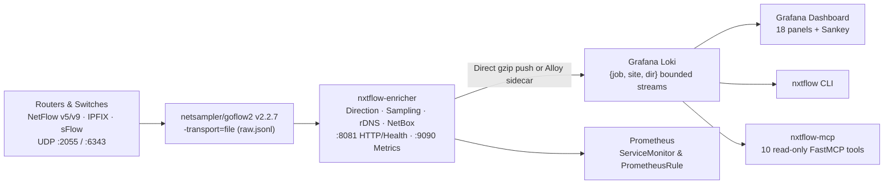

<p align="center">
  
</p>

<h1 align="center">nxtflow — AI-Ready Multi-Site NetFlow, IPFIX &amp; sFlow Telemetry</h1>

<p align="center">
  <a href="https://github.com/nertwork/nxtflow/actions/workflows/ci.yml"></a>
  <a href="https://github.com/nertwork/nxtflow/releases/latest"></a>
  <a href="https://nertwork.github.io/nxtflow/"></a>
  <a href="https://github.com/nertwork/nxtflow/pkgs/container/nxtflow-enricher"></a>
  <a href="https://github.com/nertwork/nxtflow/pkgs/container/charts%2Fnxtflow"></a>
  <a href="https://coderabbit.ai"></a>
  <a href="LICENSE"></a>
</p>

**`nxtflow`** is an open-source, Kubernetes-native **NetFlow v5/v9, IPFIX, and sFlow** observability and AI-analysis platform. It pairs upstream [`netsampler/goflow2`](https://github.com/netsampler/goflow2) with a lightweight Python enricher (`nxtflow-enricher`), bounded-cardinality Grafana Loki storage, a 18-panel Grafana dashboard, a terminal CLI (`nxtflow`), and a read-only FastMCP server (`nxtflow-mcp`) so both humans and AI coding agents can query network traffic history in seconds.

---

## Architecture



---

## Key Capabilities

- **Dual-Mode Helm Chart (`charts/nxtflow`):**
  - **Standalone (`tags.standalone=true`):** Batteries-included install deploying `loki` (SingleBinary filesystem TSDB), minimal `prometheus`, `grafana` (auto-provisioned datasources + 18-panel dashboard), `goflow2` + `nxtflow-enricher`, and `nxtflow-mcp`.
  - **Integrated (`tags.standalone=false`):** Plugs into your existing Loki, `kube-prometheus-stack` (`ServiceMonitor` + `PrometheusRule`), and Grafana sidecar (`grafana_dashboard: "1"`).
  - **Collector-Only (`examples/values-collector-only.yaml`):** Lightweight edge collector shipping flows from remote sites into a central Loki.
- **5000-Series-Safe Loki Schema:** Writes only 3 bounded stream labels per site (`{job, site, dir}`) and protects port aggregations with `dst_port =~ '.{1,4}' | __error__=''`.
- **7-Tier Host Resolution:** Combines `staticHosts`, custom `internalCidrs`, `wanIps`, optional NetBox IPAM sync, built-in public CDN/DNS CIDRs (`103` IPv4/IPv6 ranges), and a bounded LRU+TTL reverse DNS cache.
- **AI-Native Telemetry (`nxtflow` CLI & `nxtflow-mcp`):** Query top talkers, top destinations, 5-tuple host sessions, ports, and flow search via terminal or any MCP client (`stdio` or `streamable-http`).

---

## Quick Start (Helm)

### 1. Standalone (All-in-One)

Deploys the collector, enricher, Loki, Prometheus, Grafana, and MCP server in one release:

```bash
helm install nxtflow oci://ghcr.io/nertwork/charts/nxtflow \
  --namespace nxtflow --create-namespace \
  -f examples/values-standalone.yaml
```

Forward Grafana locally and open `http://localhost:3000/d/nxtflow-overview`:

```bash
kubectl port-forward -n nxtflow svc/nxtflow-grafana 3000:80
```

### 2. Integrated (Existing Loki, Prometheus & Grafana)

Connects to an existing Loki endpoint and provisions `ServiceMonitor`, `PrometheusRule`, and the Grafana dashboard ConfigMap:

```bash
helm install nxtflow oci://ghcr.io/nertwork/charts/nxtflow \
  --namespace monitoring \
  -f examples/values-integrated.yaml \
  --set externalLoki.url="https://loki.example.com"
```

### 3. Collector-Only (Remote Edge Site)

Deploys only the UDP collector and enricher for a remote branch site:

```bash
helm install nxtflow-edge oci://ghcr.io/nertwork/charts/nxtflow \
  --namespace nxtflow \
  -f examples/values-collector-only.yaml \
  --set collector.site="branch-west" \
  --set externalLoki.url="https://loki.example.com"
```

> **Note on `externalTrafficPolicy: Local`:** Keep `collector.service.externalTrafficPolicy=Local` on `LoadBalancer`/`NodePort` services so Kubernetes preserves the true source IP of your exporting routers instead of SNATing it.

---

## CLI & MCP Quick Start

Install the Python package locally (with MCP server support):

```bash
pip install "nxtflow[mcp] @ git+https://github.com/nertwork/nxtflow.git"
# or with uv:
uv tool install --from "git+https://github.com/nertwork/nxtflow.git" "nxtflow[mcp]"
```

Query Loki from your terminal:

```bash
export NXTFLOW_LOKI_URL="http://localhost:3100"
nxtflow status
nxtflow summary --range 1h
nxtflow top-talkers 10 --range 15m
nxtflow host 192.168.1.10 --range 1h
nxtflow sessions 192.168.1.10
```

Run `nxtflow-mcp` over `stdio` (see `mcp/nxtflow.mcp.json` and `skills/nxtflow/SKILL.md`):

```bash
nxtflow-mcp --transport stdio
```

---

## Exporter Configuration Guides

Ready-to-use templates live in [`examples/exporters/`](examples/exporters/):

- [MikroTik RouterOS v7](examples/exporters/mikrotik-routeros.rsc)
- [Linux `softflowd`](examples/exporters/softflowd-linux.md)
- [pfSense & OPNsense](examples/exporters/pfsense-opnsense.md)
- [Cisco IOS-XE (Flexible NetFlow)](examples/exporters/cisco-ios-xe.txt)
- [UniFi Gateway](examples/exporters/unifi-gateway.md)

---

## Documentation

Full hosted documentation is automatically published to **[`https://nertwork.github.io/nxtflow/`](https://nertwork.github.io/nxtflow/)**:

- [Documentation Home](docs/index.md)
- [System Architecture](docs/architecture.md)
- [Standalone vs. Integrated Deployment](docs/standalone-vs-integrated.md)
- [Helm Chart Reference](charts/nxtflow/README.md)
- [Exporter Guides & Tuning](docs/exporters.md)
- [CLI, MCP Server & AI Skill Integration](docs/ai-integration.md)
- [Changelog](CHANGELOG.md) & [Contributing Guide](CONTRIBUTING.md)

---

## Security & Zero-PII Guarantee

Every commit runs `scripts/zero_pii_audit.py` in CI to verify zero internal IP addresses, private hostnames, or credentials enter the repository. See [SECURITY.md](SECURITY.md) for architecture details and vulnerability reporting.

## License

Released under the [MIT License](LICENSE).
