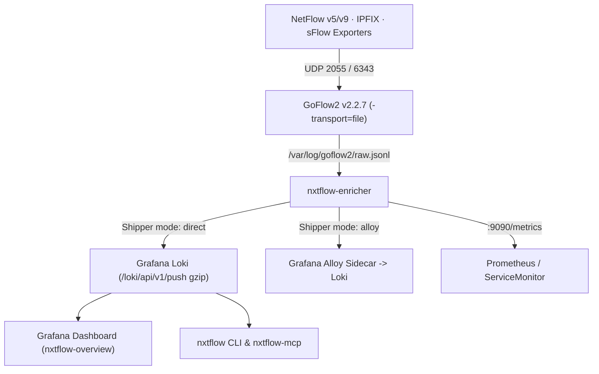

# System Architecture

`nxtflow` separates UDP packet decoding, flow enrichment, storage, and AI querying into clean, bounded-memory stages.

## Data Flow Pipeline



## Collector & Enricher Wiring

Upstream `netsampler/goflow2:v2.2.7` writes newline-delimited JSON flows via `-transport=file -transport.file=/var/log/goflow2/raw.jsonl` into a shared pod `emptyDir` mounted with `fsGroup: 65533` (`runAsUser: 100`, `runAsGroup: 65533`).

`nxtflow-enricher` concurrently runs:

- **File Tailer (`ingest.file.enabled: true`):** Tracks inode and byte offset in `positionFile`, automatically handles log truncation (`truncateAtBytes`), and survives pod restarts cleanly.
- **HTTP Ingest (`ingest.http.enabled: true` on `:8081`):** Exposes `POST /ingest`, `POST /ingest/goflow2` (single JSON, array, NDJSON, or gzip; RFC 7230 chunked transfer supported), `GET /healthz`, and `GET /readyz`.

## 7-Tier Host Resolution

For every `src_addr` and `dst_addr`, `nxtflow-enricher` resolves human-readable hostnames in deterministic order:

1. `resolution.staticHosts` (explicit IP-to-hostname overrides)
2. `classification.internalCidrs` (named internal subnets)
3. `classification.wanIps` (router WAN interface aliases)
4. **NetBox IPAM Sync** (optional paginated background sync with non-blocking `/readyz`)
5. **Public Well-Known IPs** (when `resolution.useDefaultCidrs: true`)
6. **Reverse DNS Cache** (bounded LRU+TTL `RDNSCache` with configurable `private` PTR lookup)
7. **Public CIDR Directory** (`103` built-in IPv4/IPv6 cloud, CDN, and DNS ranges)

## Loki Stream & JSON Schema

Streams use strictly three labels to prevent index cardinality growth:

```text
{job="nxtflow", site="<collector.site>", dir="up|down|lan"}
```

Each JSON log line contains 11 fields (plus optional `sampler_address` when `collector.includeSamplerLabel: true`):

| Field | Type | Description |
|---|---|---|
| `bytes` | integer | Flow byte count scaled by `sampling_rate` |
| `packets` | integer | Flow packet count scaled by `sampling_rate` |
| `src_addr` | string | Source IPv4/IPv6 address |
| `dst_addr` | string | Destination IPv4/IPv6 address |
| `src_host` | string | Resolved source hostname or label |
| `dst_host` | string | Resolved destination hostname or label |
| `proto` | string | Normalized protocol (`TCP`, `UDP`, `ICMP`, ...) |
| `src_port` | integer | Source TCP/UDP port |
| `dst_port` | integer | Destination TCP/UDP port |
| `dir` | string | Direction (`up`, `down`, or `lan`) |
| `site` | string | Collector site identifier |

## Prometheus Metrics (`:9090/metrics`)

- `nxtflow_flows_received_total{site, dir, proto}` (Counter)
- `nxtflow_bytes_total{site, dir, proto}` (Counter)
- `nxtflow_loki_push_requests_total{status}` (Counter)
- `nxtflow_loki_push_errors_total` (Counter)
- `nxtflow_dropped_flows_total` (Counter)
- `nxtflow_rdns_cache_hits_total` / `nxtflow_rdns_cache_misses_total` (Counters)
- `nxtflow_ring_buffer_size` (Gauge)
- `nxtflow_netbox_hosts_cached` (Gauge) / `nxtflow_netbox_sync_errors_total` (Counter)
