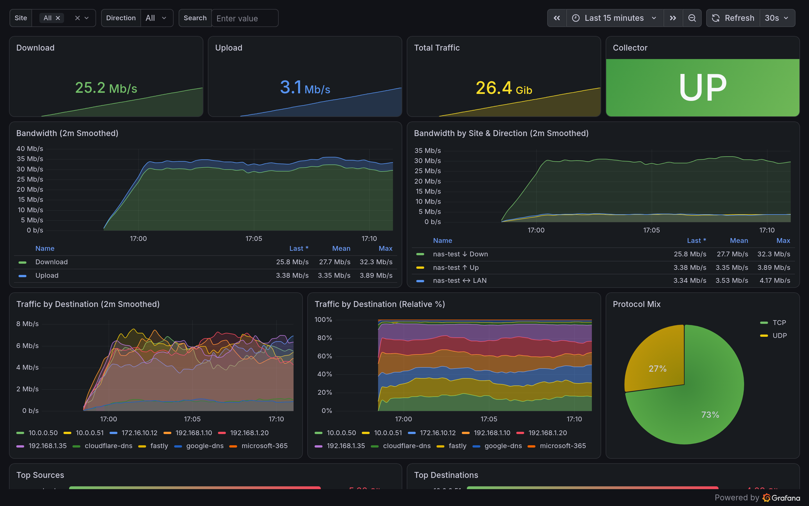
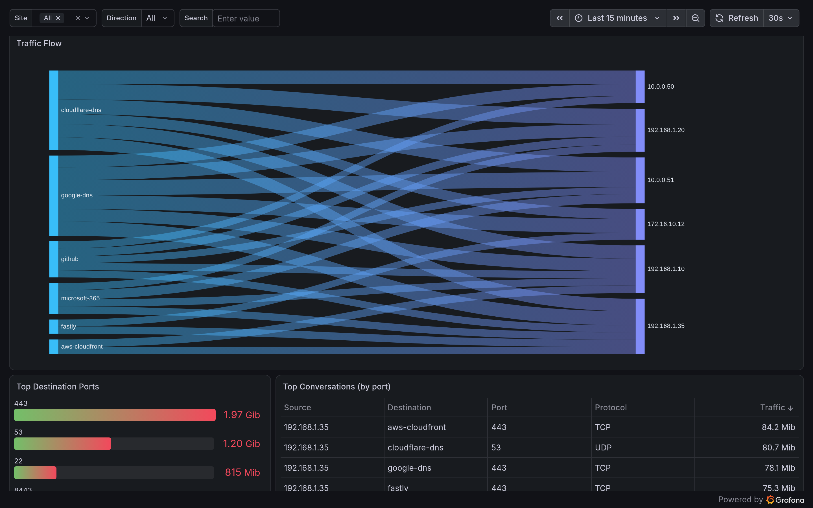
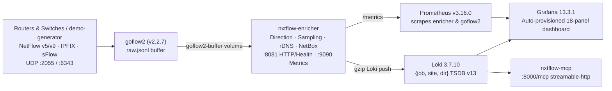

# Docker Compose Deployment Guide

Run the complete **`nxtflow`** stack on a single Linux, macOS, or homelab Docker host in under 60 seconds — including **GoFlow2**, **`nxtflow-enricher`**, **Grafana Loki**, **Prometheus**, an auto-provisioned 18-panel **Grafana** dashboard, and **`nxtflow-mcp`**.

---

## 60-Second Quick Start

```bash
git clone git@github.com:nertwork/nxtflow.git
cd nxtflow
cp .env.example .env
./scripts/up.sh --demo
./scripts/verify-stack.sh
```

What those commands do:

1. `cp .env.example .env` creates your local port, site, retention, and credential configuration.
2. `./scripts/up.sh --demo` starts all core containers plus the `--profile demo` synthetic NetFlow v9 generator so your dashboard populates immediately.
3. `./scripts/verify-stack.sh` waits for Loki, Prometheus, Enricher, MCP, and Grafana health endpoints, verifies Grafana datasource/dashboard provisioning, sends a test NetFlow v9 burst, confirms `{job="nxtflow", site="default"}` records in Loki, and prints a live CLI summary.

Open Grafana at **`http://localhost:3000/d/nxtflow-overview`** (default credentials: `admin` / `nxtflow`, or your customized `NXTFLOW_GRAFANA_PORT` / `NXTFLOW_GRAFANA_ADMIN_USER`).

> **Shortcut `Makefile` targets:** `make up`, `make up-demo`, `make verify`, `make demo`, `make logs`, `make ps`, and `make down` wrap the same Docker Compose workflow.

### Query Without Installing Python Locally

The `nxtflow-mcp` image ships the `nxtflow` CLI inside the container:

```bash
docker compose exec -e NXTFLOW_LOKI_URL=http://loki:3100 nxtflow-mcp nxtflow status --range 15m
docker compose exec -e NXTFLOW_LOKI_URL=http://loki:3100 nxtflow-mcp nxtflow summary --range 15m
docker compose exec -e NXTFLOW_LOKI_URL=http://loki:3100 nxtflow-mcp nxtflow top-talkers 10 --range 15m
```

---

## Live Grafana Dashboard Screenshots

Out of the box, Grafana provisions the **Loki** and **Prometheus** datasources alongside the **18-panel NxtFlow Overview** dashboard (including the `volkovlabs-echarts-panel` Sankey topology view):

### Overview, KPIs & Traffic Sankey



### Flow Analytics, Protocols & Top Talkers



- [Open Full-Page Dashboard Screenshot (PNG)](assets/screenshots/grafana-overview-full.png)

---

## Stack Architecture



| Service | Container / Image | Purpose |
|---|---|---|
| `init-volumes` | `busybox:1.37` | Initializes ownership on `goflow2-buffer`, `loki-data`, `prometheus-data`, `grafana-data` |
| `goflow2` | `netsampler/goflow2:v2.2.7` | Listens on UDP `:2055` (NetFlow/IPFIX) and `:6343` (sFlow) and writes JSONL to `goflow2-buffer` |
| `enricher` | `ghcr.io/nertwork/nxtflow-enricher` | Tails `raw.jsonl`, classifies `up`/`down`/`lan`, resolves hostnames, pushes gzip batches to Loki |
| `loki` | `grafana/loki:3.7.10` | SingleBinary TSDB v13 log store with bounded `{job, site, dir}` streams and compactor retention |
| `prometheus` | `quay.io/prometheus/prometheus:v3.16.0` | Scrapes `enricher:9090` (`service="nxtflow-metrics"`) and `goflow2:8080` for collector health panels |
| `grafana` | `grafana/grafana:13.3.1` | Installs `volkovlabs-echarts-panel`, provisions datasources + `nxtflow-overview.json` |
| `nxtflow-mcp` | `ghcr.io/nertwork/nxtflow-mcp` | Read-only FastMCP server over `streamable-http` (`:8000/mcp`, `/healthz`) and CLI container |
| `demo-generator` | `ghcr.io/nertwork/nxtflow-enricher` | Optional `--profile demo` service sending synthetic NetFlow v9 traffic every `2s` |

---

## Switching from Demo Traffic to Real Routers

1. **Stop the demo generator** (if started with `--demo`):

   ```bash
   docker compose --profile demo stop demo-generator
   docker compose --profile demo rm -f demo-generator
   ```

2. **Set your site name and bind IP** in `.env` (`NXTFLOW_BIND_IP=0.0.0.0` so LAN/VLAN exporters can reach the host):

   ```dotenv
   NXTFLOW_SITE=home-core
   NXTFLOW_BIND_IP=0.0.0.0
   NXTFLOW_NETFLOW_PORT=2055
   NXTFLOW_SFLOW_PORT=6343
   ```

3. **Customize host classification & aliases** in `docker/enricher/enricher.yaml`:
   - Add your router's external IP(s) to `classification.wanIps`
   - Confirm your internal subnets under `classification.localCidrs`
   - Add friendly device names under `resolution.staticHosts` (for example `"192.168.1.1": "core-router"`)
   - Recreate the enricher so changes take effect:

     ```bash
     docker compose up -d --force-recreate enricher
     ```

4. **Point your router or switch at `<docker-host-ip>:2055` (NetFlow v5/v9/IPFIX) or `:6343` (sFlow v5):**
   - [MikroTik RouterOS v7](../examples/exporters/mikrotik-routeros.rsc) — `/ip traffic-flow` + target UDP `2055`
   - [UniFi Gateways](../examples/exporters/unifi-gateway.md) — Settings -> CyberSecure / Traffic -> NetFlow v9 to `<docker-host-ip>:2055`
   - [pfSense & OPNsense](../examples/exporters/pfsense-opnsense.md) — `softflowd` / `ng_netflow` targeting `<docker-host-ip>:2055`
   - [Cisco IOS-XE](../examples/exporters/cisco-ios-xe.txt) — Flexible NetFlow exporter to `<docker-host-ip>:2055`
   - [Linux `softflowd`](../examples/exporters/softflowd-linux.md) — Host/bridge export with `not port 2055` loop filter

   See [Exporter Guides & Tuning](exporters.md) for sampling rate and firewall tips.

---

## `.env` Configuration Reference

| Variable | Default | Description |
|---|---|---|
| `NXTFLOW_SITE` | `default` | `site` label attached to Loki streams (`{job, site, dir}`) |
| `NXTFLOW_JOB` | `nxtflow` | Loki `job` label (also injected into the Grafana dashboard queries) |
| `NXTFLOW_LOG_LEVEL` | `INFO` | Enricher log level (`DEBUG`, `INFO`, `WARNING`, `ERROR`) |
| `NXTFLOW_IMAGE_TAG` | `latest` | Container tag for `ghcr.io/nertwork/nxtflow-{enricher,mcp}` |
| `NXTFLOW_BIND_IP` | `0.0.0.0` | Host interface bind IP (`0.0.0.0` for LAN routers, `127.0.0.1` for local-only) |
| `NXTFLOW_NETFLOW_PORT` | `2055` | Host UDP port for NetFlow v5/v9 and IPFIX |
| `NXTFLOW_SFLOW_PORT` | `6343` | Host UDP port for sFlow v5 |
| `NXTFLOW_GRAFANA_PORT` | `3000` | Host HTTP port for Grafana UI (e.g., set `3030` if `3000` is in use) |
| `NXTFLOW_LOKI_PORT` | `3100` | Host HTTP port for Loki API |
| `NXTFLOW_PROMETHEUS_PORT` | `9091` | Host HTTP port for Prometheus UI |
| `NXTFLOW_ENRICHER_HTTP_PORT` | `8081` | Host HTTP port for Enricher `/ingest`, `/healthz`, and `/readyz` |
| `NXTFLOW_ENRICHER_METRICS_PORT` | `9090` | Host HTTP port for Enricher `/metrics` |
| `NXTFLOW_GOFLOW2_METRICS_PORT` | `8080` | Host HTTP port for GoFlow2 `/metrics` |
| `NXTFLOW_MCP_PORT` | `8000` | Host HTTP port for `nxtflow-mcp` (`/mcp` and `/healthz`) |
| `NXTFLOW_GRAFANA_ADMIN_USER` | `admin` | Initial Grafana administrator username |
| `NXTFLOW_GRAFANA_ADMIN_PASSWORD` | `nxtflow` | Initial Grafana administrator password |
| `NXTFLOW_GRAFANA_ANONYMOUS_ENABLED` | `false` | Allow unauthenticated read-only `Viewer` access in Grafana |
| `NXTFLOW_LOKI_RETENTION` | `168h` | Loki TSDB compactor retention period (default 7 days) |
| `NXTFLOW_NETBOX_ENABLED` | `false` | Enable background NetBox IPAM hostname sync in `nxtflow-enricher` |
| `NXTFLOW_NETBOX_URL` | `""` | NetBox base URL when `NXTFLOW_NETBOX_ENABLED=true` |
| `NXTFLOW_NETBOX_TOKEN` | `""` | NetBox API token (`read-only` sufficient) |
| `NXTFLOW_NETBOX_TLS_VERIFY` | `true` | Verify NetBox TLS certificates (`true` or `false`) |
| `NXTFLOW_DEMO_PROTOCOL` | `netflow9` | Protocol used by `demo-generator` (`netflow9` or `netflow5`) |
| `NXTFLOW_DEMO_INTERVAL` | `2` | Seconds between synthetic flow batches |
| `NXTFLOW_DEMO_BATCH_SIZE` | `12` | Flows emitted per batch by `demo-generator` |

---

## Troubleshooting & Clean Teardown

### Port Already in Use (e.g., `3000`, `8080`, or `9090`)

Update the colliding port in `.env` (for example `NXTFLOW_GRAFANA_PORT=3030`) and re-run `./scripts/up.sh`. `docker-compose.yml` interpolates every host port from `.env`.

### No Flows Appearing in Grafana

1. Send a manual synthetic test burst and check Loki ingestion:

   ```bash
   ./scripts/verify-stack.sh
   ```

2. If synthetic flows work locally but router flows do not appear:
   - Verify host firewall allows inbound **UDP `2055`** (or `6343` for sFlow) from the router's management/source IP.
   - Check `goflow2` and `enricher` logs:

     ```bash
     docker compose logs --tail=50 goflow2 enricher
     ```

   - Ensure the Grafana **Site** dropdown matches `NXTFLOW_SITE` in `.env`.

### Clean Teardown

Stop containers while keeping Loki, Prometheus, and Grafana volumes intact:

```bash
docker compose --profile demo down
```

Stop containers **and delete all persisted volumes** for a fresh start:

```bash
docker compose --profile demo down -v
```
