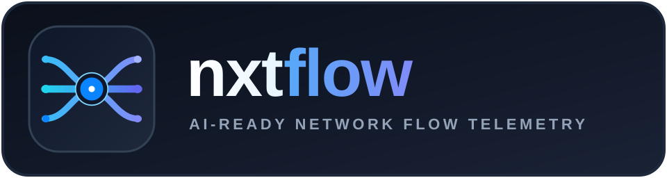
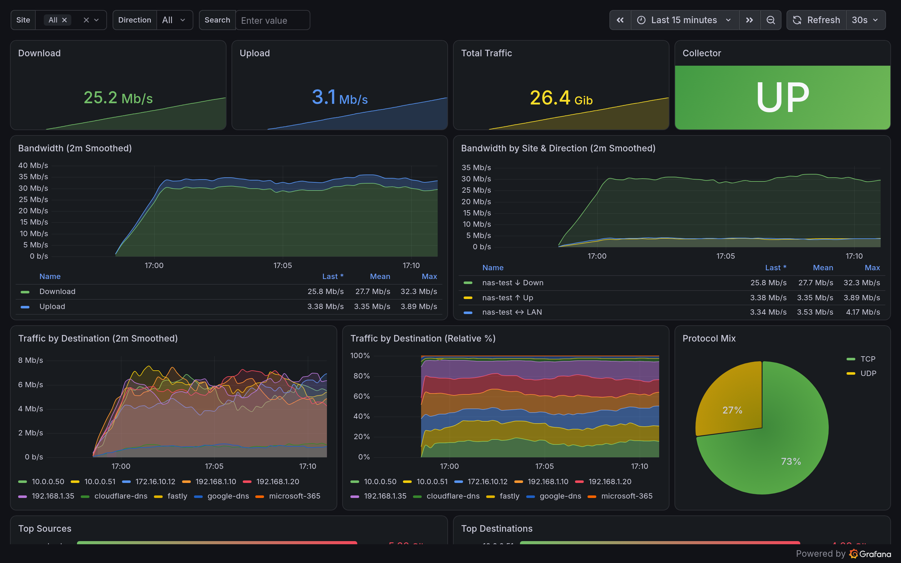
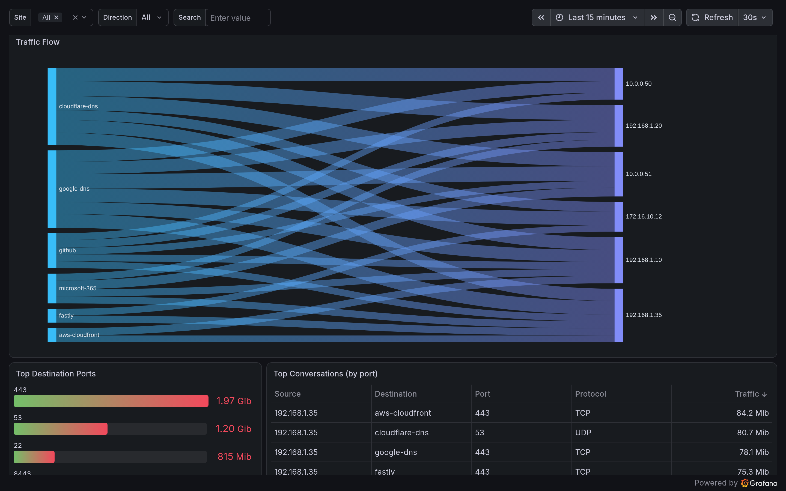

<p align="center">
  
</p>

# nxtflow Documentation

Welcome to **`nxtflow`** — an open-source, AI-ready NetFlow v5/v9, IPFIX, and sFlow telemetry platform designed for Docker Compose, Kubernetes, Grafana Loki, Prometheus, and AI coding assistants.

## Fastest — 60s Setup (Docker Compose)

Launch the full standalone stack (**GoFlow2 + `nxtflow-enricher` + Loki + Prometheus + Grafana + `nxtflow-mcp`**) in three commands:

```bash
cp .env.example .env
./scripts/up.sh --demo
./scripts/verify-stack.sh
```

Open **`http://localhost:3000/d/nxtflow-overview`** (`admin` / `nxtflow`) — datasources and the 18-panel dashboard are provisioned automatically.

-> **[Read the complete Docker Compose Deployment Guide](docker-compose.md)**

---

## Live Grafana Dashboard





- [View Full-Page Dashboard Screenshot (PNG)](assets/screenshots/grafana-overview-full.png)

---

## Choose Your Deployment Path

| Path | Best For | Guide |
|---|---|---|
| **Docker Compose** | Single-host homelabs, Docker servers, and 60s evaluations | [Docker Compose Guide](docker-compose.md) |
| **Kubernetes / Helm** | Production clusters (Standalone, Integrated, or Collector-Only) | [Helm Chart Reference](../charts/nxtflow/README.md) · [Deployment Modes](standalone-vs-integrated.md) |
| **Router & Firewall Exporters** | MikroTik, UniFi, pfSense/OPNsense, Cisco IOS-XE, Linux `softflowd` | [Exporter Guides](exporters.md) |
| **CLI, MCP & AI Agents** | Terminal queries (`nxtflow`) and FastMCP tools (`nxtflow-mcp`) | [CLI, MCP Server & AI Skill](ai-integration.md) |

---

## Why `nxtflow`?

Traditional NetFlow stacks either rely on heavy proprietary appliances or explode Loki/Prometheus cardinality when storing per-flow IP pairs as stream labels. **`nxtflow`** keeps storage fast and predictable by bounding Loki stream labels to `{job, site, dir}` while storing rich 11-field JSON records ready for instant LogQL aggregation, Grafana visualization, and MCP tool queries.

## Feature Matrix

| Component | Purpose | Interfaces |
|---|---|---|
| `netsampler/goflow2:v2.2.7` | Multi-protocol UDP flow collector (NetFlow v5/v9, IPFIX, sFlow v5) | UDP `:2055`, `:6343`; `-transport=file` JSONL |
| `nxtflow-enricher` | Sampling scaler, `up`/`down`/`lan` classifier, 7-tier host resolver, gzip Loki shipper | `:8081` (`/ingest`, `/healthz`, `/readyz`), `:9090` (`/metrics`) |
| `docker-compose.yml` | Turnkey standalone Docker Compose stack (GoFlow2, Enricher, Loki, Prometheus, Grafana, MCP) | `.env.example`, `./scripts/up.sh`, `--profile demo` |
| `charts/nxtflow` | Dual-mode Helm chart (`standalone`, `integrated`, `collector-only`) | Helm v4, OCI `ghcr.io/nertwork/charts/nxtflow` |
| `nxtflow-overview.json` | 18-panel multi-site Grafana dashboard with dynamic `site` discovery & Sankey | Grafana 10–13 (`volkovlabs-echarts-panel` or `netsage-sankey-panel`) |
| `nxtflow` CLI | Fast terminal traffic inspection with table and `--json` output | 11 subcommands (`status`, `summary`, `top-talkers`, `host`, `sessions`, ...) |
| `nxtflow-mcp` | Read-only FastMCP server (`stdio` and `streamable-http`) | 10 bounded tools + `/healthz` |
| `skills/nxtflow/SKILL.md` | AgentSkills.io portable skill for Gemini, Claude, OpenCode, and Codex | `<150`-token workflow |

## Documentation Map

- [Docker Compose Guide](docker-compose.md) — 60s Quick Start, `.env` reference, router switching, and troubleshooting.
- [System Architecture](architecture.md) — Collector pipeline, 7-tier host resolution, Loki JSON schema, and Prometheus metrics.
- [Standalone vs. Integrated Modes](standalone-vs-integrated.md) — Choosing between Docker Compose, bundled Helm, existing observability integration, and edge collectors.
- [Helm Chart Reference](../charts/nxtflow/README.md) — Chart deployment modes, OCI install commands, and configuration values.
- [Exporter Guides](exporters.md) — Router, firewall, and Linux `softflowd` configuration guides.
- [CLI, MCP Server & AI Skill](ai-integration.md) — Using `nxtflow`, `nxtflow-mcp`, and `SKILL.md` with AI agents.
- [Changelog](../CHANGELOG.md) — Release history and component highlights.

## Quality & Automated Verification

Every release and pull request is validated through automated GitHub Actions checks:

- **Lint, Syntax & Security Audit:** Automated credential, private key, and Python/JSON syntax checks (`scripts/security_audit.py`).
- **Python Lint & Unit Tests:** `ruff` checks and `pytest` suites covering the CLI, enricher, Compose config, and MCP server.
- **Helm Lint, Schema & Template:** Multi-mode `helm lint`, `values.schema.json` validation, `ct lint`, and Kind cluster `helm test` smoke tests.
